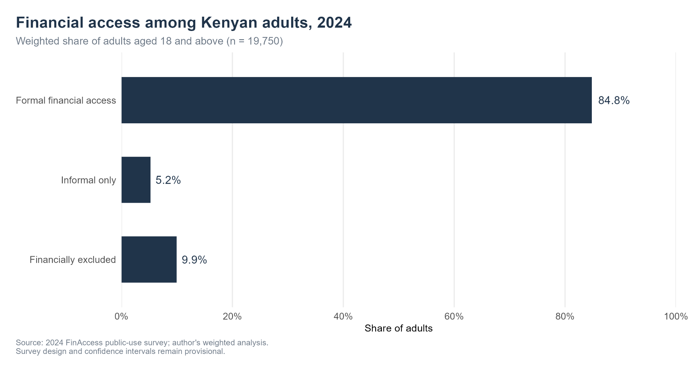
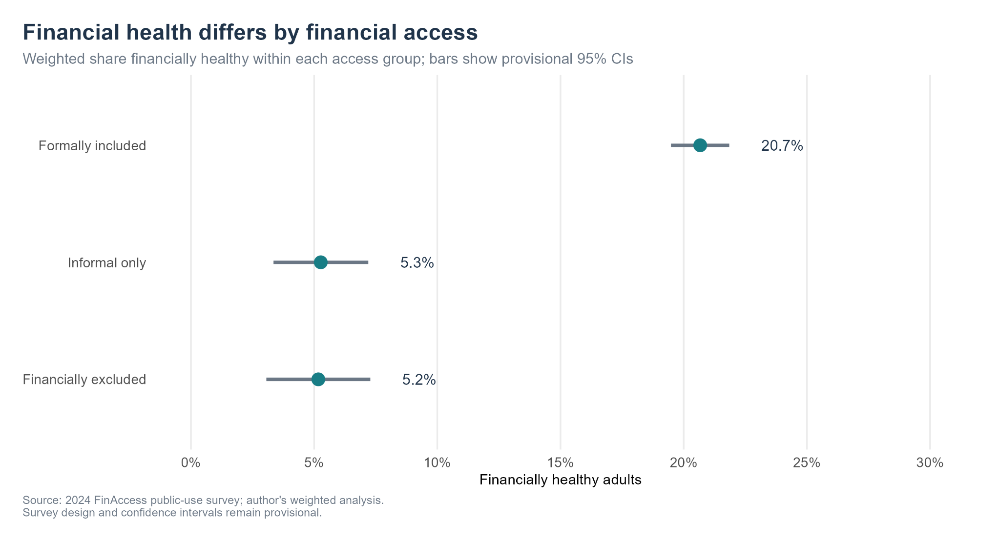
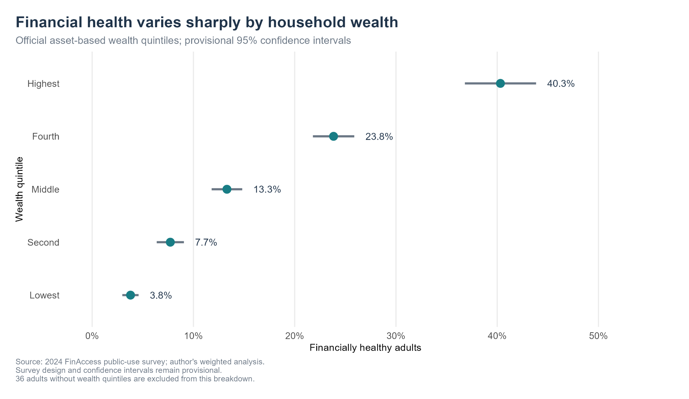
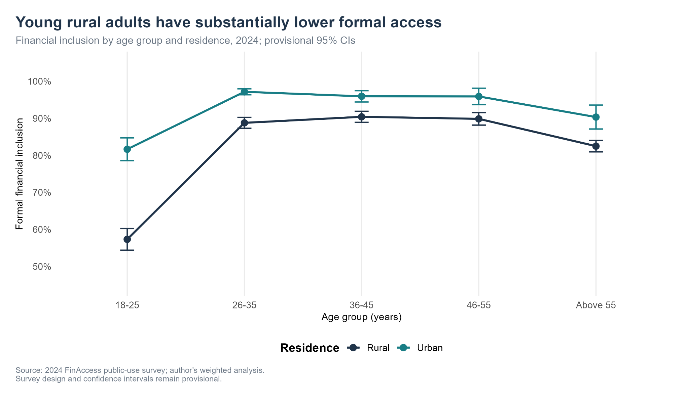
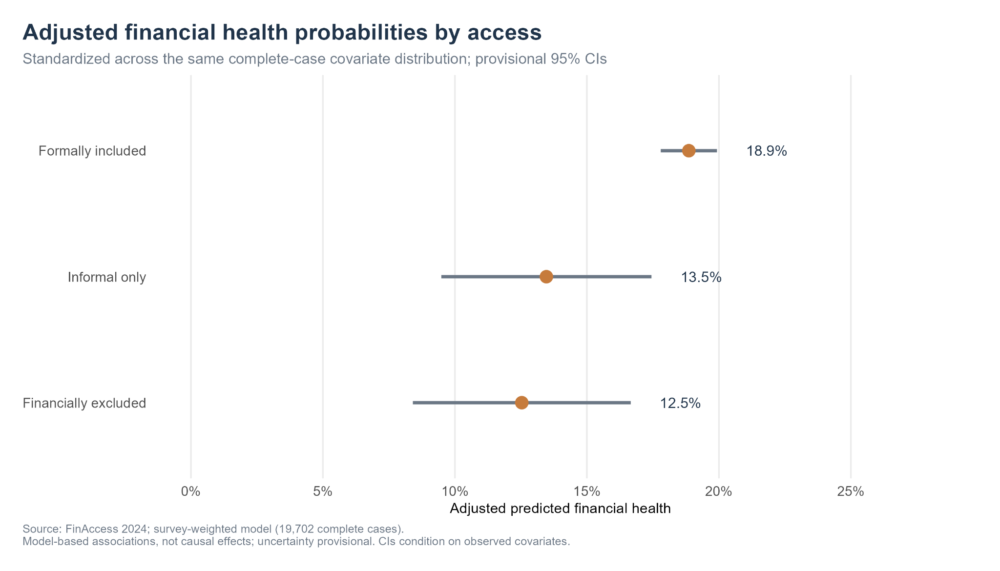
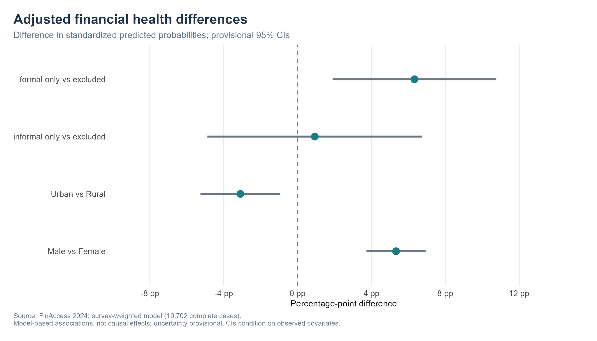

::: {.fa24-wrapper}

```{=html}
<div class="fa24-hero" role="region" aria-label="Financial inclusion and financial health study">
  
  <div class="fa24-hero-shade"></div>
  <div class="fa24-hero-content">
    <h1>Financial Inclusion and Financial Health in Kenya, 2024</h1>
    <p class="fa24-lead">An independent, survey-weighted analysis of financial access and financial health in Kenya.</p>
    <div class="fa24-tags"><span>FINANCIAL INCLUSION</span><span>RESEARCH</span><span>SURVEY ANALYSIS</span><span>STATISTICS</span><span>R</span></div>
    <p class="fa24-description">Socioeconomic disparities by household wealth, education, livelihood, residence and demographic characteristics in the 2024 FinAccess survey.</p>
    <div class="fa24-byline"><div><small>AUTHOR</small><strong>Aran Felix</strong></div><div><small>PUBLISHED</small><strong>6 November 2026</strong></div></div>
  </div>
</div>
```

<div class="fa24-pills"><span><strong>Author:</strong> Aran Felix</span><span><strong>Survey:</strong> FinAccess 2024</span><span><strong>Coverage:</strong> 47 counties</span><span><strong>Methods:</strong> R, survey-weighted analysis and exploratory regression</span><span><strong>Sample:</strong> 19,750 adults</span></div>

<div class="fa24-metrics">
<div class="fa24-metric"><strong>84.8%</strong><span>Formal financial inclusion</span></div>
<div class="fa24-metric"><strong>18.3%</strong><span>Financially healthy adults</span></div>
<div class="fa24-metric"><strong>9.9%</strong><span>Financially excluded adults</span></div>
<div class="fa24-metric"><strong>40.3% vs 3.8%</strong><span>Financial health: highest and lowest wealth quintiles</span></div>
</div>


<div class="fa24-actions">
  <a class="fa24-btn-primary"
     href="https://public.tableau.com/views/FinAccess2024FinancialInclusionandFinancialHealthinKenya/FinancialInclusionOverview"
     target="_blank"
     rel="noopener noreferrer">
    Explore Interactive Dashboard ↗
  </a>

  <a class="fa24-btn-outline"
     href="../files/finaccess-2024/FinAccess_2024_Research_Felix_Aran.pdf"
     target="_blank"
     rel="noopener noreferrer">
    Read Full Research Report (PDF) ↗
  </a>
</div>


## Executive summary {#executive-summary}

Kenya's formal financial inclusion is widespread, but financial health remains much lower. I analysed the 2024 FinAccess Household Survey to examine access to formal and informal financial services, financial health, and disparities by sex, age, rural–urban residence, education, livelihood and household wealth. The main adult sample contains **19,750 respondents**. I applied the supplied individual survey weights and reproduced the official national indicators: **84.8% formal financial access, 9.9% financial exclusion and 18.3% financial health**. These results show why access and wellbeing must be measured separately. The observed 2024 patterns provide evidence for more focused financial inclusion monitoring, but the survey does not establish whether access itself causes better outcomes.

The descriptive financial health rate was **20.7%** among formally included adults, **5.3%** among adults using informal services only and **5.2%** among financially excluded adults. Financial health was also markedly unequal across household wealth groups, ranging from **3.8%** in the lowest quintile to **40.3%** in the highest. In exploratory survey-weighted models based on 19,702 complete cases, formal inclusion remained positively associated with financial health after socioeconomic adjustment (**adjusted odds ratio 1.81**). The model-standardized probability difference was **6.33 percentage points** (provisional 95% interval, 1.89–10.76). These adjusted estimates require additional design verification and should not be interpreted causally.

## Questions this research addresses

<div class="fa24-question-grid">
<div><strong>Access</strong><p>How common are formal inclusion, informal-only access and financial exclusion?</p></div>
<div><strong>Financial health</strong><p>Which groups are financially healthy, and how does that differ from access?</p></div>
<div><strong>Inequality</strong><p>How do age, sex, residence, education, livelihood and wealth relate to these patterns?</p></div>
<div><strong>Adjusted associations</strong><p>Does the financial access association persist after adjusting for selected socioeconomic characteristics?</p></div>
</div>

## Key findings

**Financial access does not equal financial health.** National formal access reached 84.8%, while only 18.3% of adults met the survey's financial health criteria. These indicators measure different outcomes; their difference is not the proportion of included adults who are unhealthy.

**Household wealth is closely associated with financial health.** The highest wealth quintile had an estimated financial health rate of 40.3% versus 3.8% in the lowest quintile. Wealth quintiles reflect an asset-based measure of living standards, not observed monthly incomes.

**Young rural adults face a pronounced access gap.** Formal inclusion among rural adults aged 18–25 was 57.3%, compared with 81.7% among urban adults of the same age group. This is a descriptive cross-sectional comparison, not a longitudinal age trend.

**Financial health differs by sex and residence.** The weighted rates were 9.1% among rural women, 16.4% among rural men, 22.6% among urban women and 30.1% among urban men. These group estimates are descriptive and may reflect multiple overlapping socioeconomic factors.

**The adjusted access relationship remains positive, but is not causal.** The fitted health model estimated an adjusted odds ratio of 1.81 for formal inclusion compared with exclusion. Adjusted predicted probabilities differ by 6.33 percentage points. This exploratory association does not estimate the effect of providing an account.

## Results and figures {#results-and-figures}

The figures below were produced from aggregate statistical outputs. They reproduce the findings of the research workflow; uncertainty intervals remain provisional.

<div class="fa24-figure-grid">
<figure><figcaption><strong>Figure 1.</strong> National financial access among adults in 2024. Weighted point estimates.</figcaption></figure>
<figure><figcaption><strong>Figure 2.</strong> Financial health by access category. Provisional confidence intervals.</figcaption></figure>
<figure><figcaption><strong>Figure 3.</strong> Financial health by relative household wealth. Provisional confidence intervals.</figcaption></figure>
<figure><figcaption><strong>Figure 4.</strong> Age and rural–urban differences in formal access; cross-sectional groups.</figcaption></figure>
</div>

### Exploratory adjusted estimates

The adjusted analyses use **19,702 complete cases**. The estimates compare model-based predictions standardized over the same observed complete-case distribution. They are conditional, exploratory comparisons and do not represent the impact of a policy intervention.

<div class="fa24-figure-grid fa24-figures-two">
<figure><figcaption><strong>Figure 5.</strong> Model-standardized financial health by access. Provisional intervals.</figcaption></figure>
<figure><figcaption><strong>Figure 6.</strong> Selected adjusted differences; none should be interpreted causally.</figcaption></figure>
</div>

## Data and methods {#methods-and-limits}

I used the **2024 FinAccess Household Survey public-use dataset**, produced by the Central Bank of Kenya, the Kenya National Bureau of Statistics and FSD Kenya. The source contains 20,871 completed interviews; the survey's adult filter identifies 19,750 eligible adults aged 18 or older. I retained the original dataset unchanged and used scripted cleaning and validation. The analysis uses individual-level survey weights, descriptive estimates, exploratory comparisons and survey-weighted logistic regression. A full methodological audit documents special age codes, 36 missing wealth classifications, the 48 complete-case exclusions and the replication of official national estimates.

The official sampling documentation describes 92 geographic/residence strata and a planned sample of 1,885 enumeration areas. The public-use file contains 1,849 observed distinct cluster identifiers. The survey manual identifies A7 as the KNBS-provided cluster number and A8 as the KNBS-defined rural/urban type. I reconstructed the candidate design from those variables and county codes, but the original variance-estimation identifiers have not been independently certified. Confidence intervals, significance tests and adjusted-prediction uncertainty are therefore **provisional**. The vulnerability index was excluded from the main models because its original construction could not be adequately established.

**Additional limitations:** This is a cross-sectional observational analysis. Associations cannot establish causation, and unmeasured confounding is possible. Adjusted probability intervals condition on the observed covariate distribution. The published manuscript retains the documented survey-design qualifications; confidence intervals and model-based inference remain provisional.

<div class="fa24-method-note" role="note"><strong>Methodological transparency.</strong> The national weighted point estimates reproduce official FinAccess 2024 benchmarks. Confidence intervals, p-values and adjusted-model inference remain <strong>provisional</strong> because the public-use variance-design identifiers have not been independently certified. The study reports associations, not causal effects.</div>

## Research materials

<div class="fa24-deliverables">
<div><strong>Full research manuscript</strong><span><a href="../files/finaccess-2024/FinAccess_2024_Research_Felix_Aran.pdf" target="_blank" rel="noopener noreferrer">Read the published 24-page PDF report ↗</a>. This is the author-approved, unchanged document.</span></div>

<div>
  <strong>Tableau Public dashboard</strong>
  <span>
    <a href="https://public.tableau.com/views/FinAccess2024FinancialInclusionandFinancialHealthinKenya/FinancialInclusionOverview"
       target="_blank"
       rel="noopener noreferrer">
      Explore the interactive Tableau dashboards ↗
    </a>.
    Explore three dashboards covering national financial inclusion,
    socioeconomic inequalities, and adjusted statistical associations.
    All results follow the approved research manuscript.
  </span>
</div>
<div><strong>Research methods</strong><span>Survey weighting, subgroup comparisons and exploratory adjusted associations; uncertainty remains qualified in the report.</span></div>
<div><strong>Reproducibility</strong><span>Analysis scripts and aggregate research outputs are maintained separately. No respondent-level records are published on this portfolio.</span></div>
</div>

**Official sources:** [2024 FinAccess Household Survey report (Central Bank of Kenya)](https://www.centralbank.go.ke/wp-content/uploads/2024/12/2024-FINACCESS-HOUSEHOLD-SURVEY-MAIN-REPORT.pdf) · [2024 FinAccess Survey Manual](https://www.centralbank.go.ke/wp-content/uploads/2024/12/2024-FinAccess-Household-Survey-Manual.pdf).

<div class="fa24-art-note">Cover artwork is AI-generated and illustrative. It does not depict a documented survey participant or recorded fieldwork.</div>

<div class="fa24-actions"><a class="fa24-btn-outline" href="../projects.qmd">← All projects</a></div>
:::
