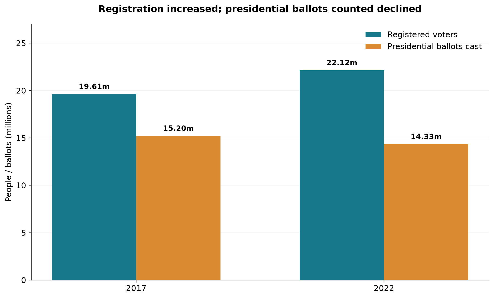
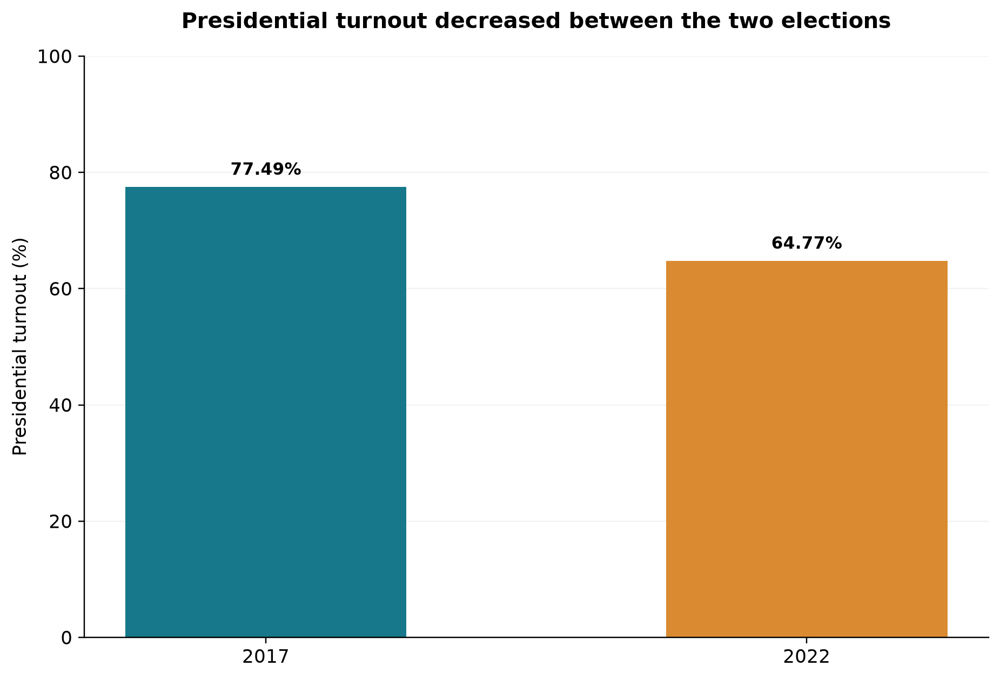
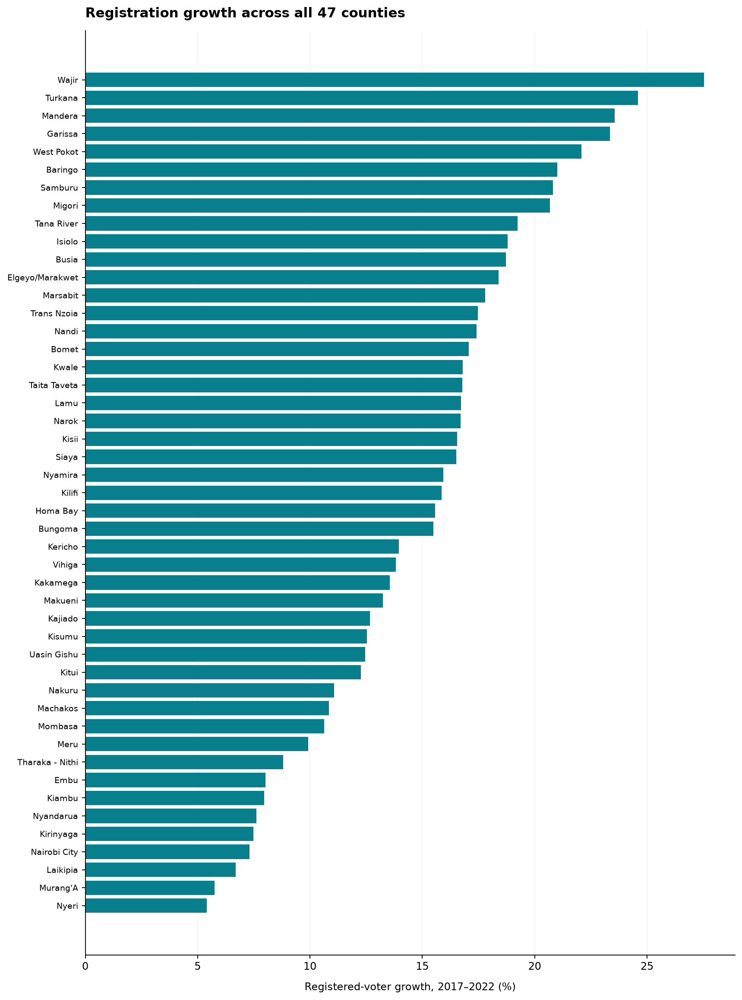
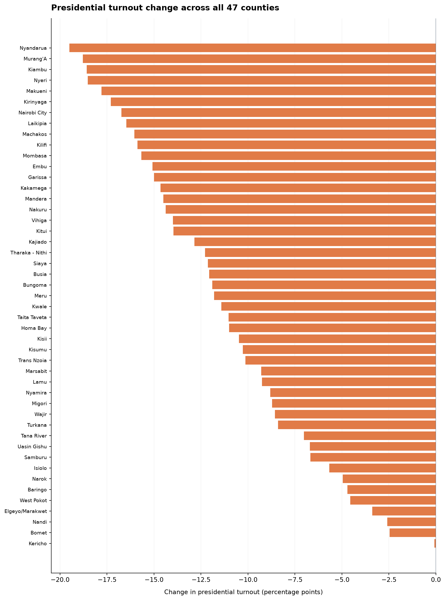
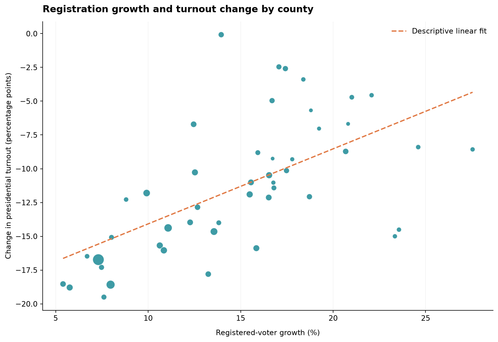
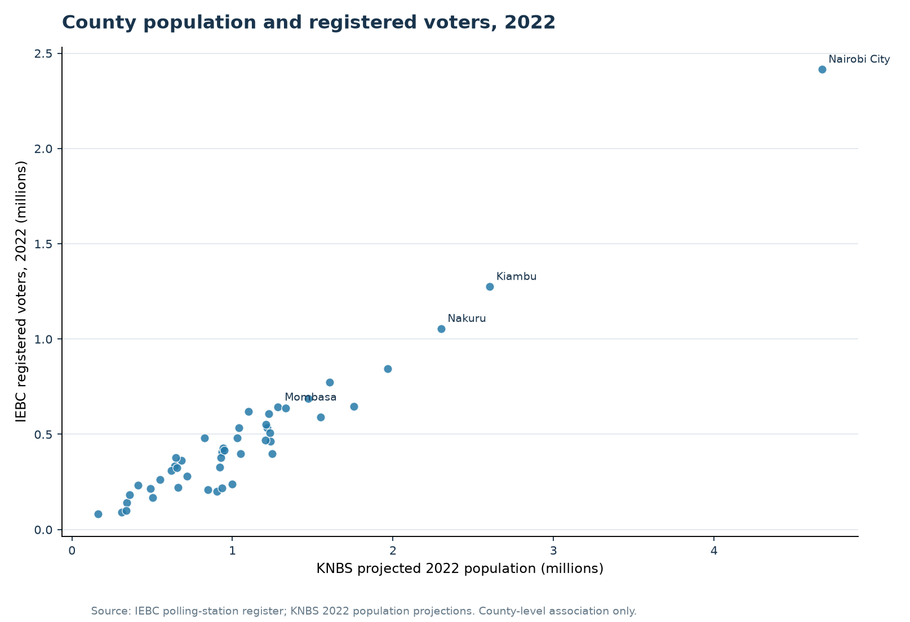
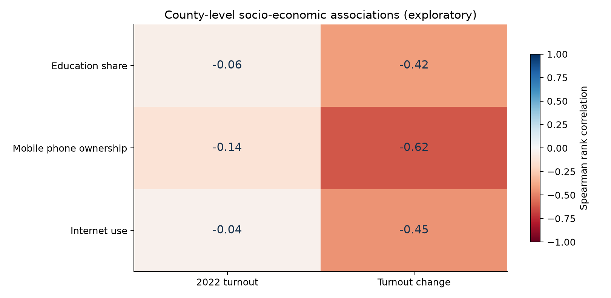

<!-- BEGIN PHASE 8.3 ELECTION IMAGE INTEGRATION -->

<!-- END PHASE 8.3 ELECTION IMAGE INTEGRATION -->

  
<strong>Author:</strong> Aran Felix

  
<strong>Study period:</strong> 2017–2022

  
<strong>Coverage:</strong> 47 counties

  
<strong>Methods:</strong> Python, descriptive statistics, correlations and geospatial analysis

  
<strong>Research:</strong> completed; interactive dashboard published

  
<b>+2.51 million</b><small>additional registered voters nationally</small>

  
<b>+12.79%</b><small>change in national registration, 2017–2022</small>

  
<b>−12.72 pp</b><small>change in national presidential turnout</small>

  
<b>47 of 47</b><small>counties with registration growth and lower presidential turnout</small>

[Explore Interactive Dashboard](https://aranfelix.github.io/kenya-registered-voters-analysis/){.btn .btn-primary} [Read Full Research Report (PDF)](../files/Mapping_Kenyas_Electorate_2017-2022_Aran_Felix_REVISED.pdf){.btn .btn-outline-secondary}

## Executive Summary

Kenya’s registered electorate grew between the 2017 and 2022 general elections, but presidential participation did not follow the same pattern. I examined the Independent Electoral and Boundaries Commission’s (IEBC) voter-registration and presidential-results publications alongside Kenya National Bureau of Statistics (KNBS) population and socioeconomic data. The validated research covers 47 counties, 290 constituencies and 1,450 wards. National registration rose from 19,611,423 voters in 2017 to 22,120,458 in 2022, an increase of 2,509,035 (12.79%). Over the same period, counted presidential ballots fell from 15,196,307 to 14,326,751. National turnout therefore declined from 77.49% to 64.77%, or 12.72 percentage points. Every county recorded growth in registered voters and a decrease in presidential turnout, although the size of these changes differed substantially. Two constituencies and 16 wards recorded declines in registration even as their wider counties grew. I also examined population size, density, education and information-technology indicators to describe county-level associations. Those relationships are exploratory and cannot establish individual voting behaviour or causes of turnout change. This project demonstrates how careful data extraction, validation, geographic matching and transparent interpretation can turn complex administrative records into evidence that researchers, journalists and public-sector planners can examine. The **[full research report](../files/Mapping_Kenyas_Electorate_2017-2022_Aran_Felix_REVISED.pdf)** provides detailed tables, figures, source definitions and limitations.

## Research Background and Questions

A rise in the number of registered voters does not necessarily mean that more people cast ballots. Registration measures the size of an administrative roll; turnout uses a defined denominator to assess election-day participation. A county may add registered voters while recording lower turnout, and aggregate changes can hide different patterns across constituencies and wards. To examine these distinctions, the study asks how registration changed between the two election cycles, where changes were concentrated, how presidential turnout shifted, and how geographic variation relates to selected population and socioeconomic measures. The analysis is descriptive rather than causal. It provides a historical comparison that readers can check against original electoral and census publications, rather than a prediction of subsequent election outcomes. Previous research also shows why election administration and political circumstances matter when interpreting participation (Harris, 2021; Cheeseman et al., 2019, 2024).

## Data and Methodology

The analysis draws on two IEBC polling-station register publications, the IEBC’s presidential-results documents for the **8 August 2017** and **9 August 2022** general elections, KNBS 2019 census volumes, and KNBS county population projections for 2022. I extracted registration records from PDF tables, standardized geographic identifiers, examined duplicate and shifted headings, and checked derived counts against the original publications. The resulting geographic panel contains 47 counties, 290 constituencies and 1,450 wards in each election year. I used descriptive totals, absolute and percentage changes, national and county turnout rates, Pearson correlations and Spearman rank correlations. The full report records how each statistic was constructed and identifies where the sources do not use identical population or electoral denominators.

National and county-only registration figures are **not interchangeable**. The published national totals include non-geographic registration categories, while the mapped analysis covers the 47 geographic counties. The corresponding county-only totals are 19,601,502 in 2017 and 22,102,532 in 2022. The demographic analysis uses actual observations from the 2019 census and **projections** for 2022 population. For example, a count of registered voters per 1,000 projected residents is not a registration rate among eligible adults, and it must not be described as one. I preserved source discrepancies in the research record instead of adjusting published values without documentation.

## Findings and Statistical Results

### 1. National Registration Increased as Presidential Turnout Fell

| Indicator | 2017 | 2022 |
|:--|--:|--:|
| Registered voters (national) | 19,611,423 | 22,120,458 |
| Counted presidential ballots | 15,196,307 | 14,326,751 |
| Presidential turnout | 77.49% | 64.77% |

The 2017-to-2022 comparison shows that registered voters increased by 2,509,035 while counted presidential ballots decreased by 869,556. The turnout gap widened because more people were registered but fewer ballots were counted. These indicators use the IEBC’s published national register and presidential ballot totals; they do not measure participation in other contests such as gubernatorial or parliamentary races. The figures below place both outcomes on separate, clearly labelled scales. They answer different questions: the first compares absolute counts, while the second shows turnout as a share of registered voters.

::: {.kenya-figure}
{#fig-national-counts width="100%" fig-alt="Side-by-side comparison of the national registered-voter totals and counted presidential ballots in Kenya's 2017 and 2022 general elections."}
:::

::: {.kenya-figure}
{#fig-national-turnout width="100%" fig-alt="Bar chart showing national presidential turnout falling from 77.49 percent in August 2017 to 64.77 percent in August 2022."}
:::

### 2. County Growth Was Uneven

Every geographic county recorded an increase in registered voters. **Nairobi City added 164,457 voters**, the largest absolute increase, followed by Nakuru (+105,238) and Kakamega (+100,815). In contrast, **Wajir recorded the largest proportional growth (27.54%)**, followed by Turkana (24.60%) and Mandera (23.56%). Nairobi’s high absolute gain and relatively modest percentage growth (7.31%) illustrate why counts and percentages should be examined together. County presidential turnout fell across the board, but the size of the decline varied. Nyandarua’s decline of 19.50 percentage points was among the largest, while Kericho’s was only 0.08 percentage points. The maps and detailed county dashboard planned for the next phase will make these contrasts easier to explore across the entire country.

::: {.kenya-figure}
{#fig-county-growth width="100%" fig-alt="Ranked chart showing percentage growth in registered voters by county between 2017 and 2022; all 47 counties recorded increases."}
:::

::: {.kenya-figure}
{#fig-county-turnout width="100%" fig-alt="Ranked county-level changes in presidential turnout between the 2017 and 2022 general elections, measured in percentage points."}
:::

### 3. Local Areas Did Not All Follow Their County Trends

County-level growth concealed decreases in **two of 290 constituencies** and **16 of 1,450 wards**. That result matters because a regional total can increase even when some component areas decline. The observed changes may reflect different demographic, administrative or geographical circumstances, but the two election snapshots cannot establish the reason for a specific local decline. For this reason, the study avoids treating changes in individual polling-station rows as evidence that a physical polling location opened or closed; one building may contain multiple administrative station records. The geographic comparison also checks available names and codes before attributing differences to the same location across years. Constituency and ward details remain available in the supporting research tables and will be integrated into the dedicated county explorer.

### 4. Registration Growth and Turnout Change Were Associated Across Counties

Across 47 counties, the Pearson correlation between **percentage registration growth** and **change in presidential turnout** was **r = 0.604**, while Spearman’s rank correlation was **ρ = 0.689**. The positive sign needs careful interpretation because county turnout changes were negative: counties with stronger registration growth tended, on average, to record *smaller* turnout declines. This relationship does not mean that registering more voters caused turnout to improve or that a particular voter was more likely to participate. The plotted dots represent counties, not individual voters, and the results reflect two election years rather than repeated observation of a long-term trend. The companion report explains the indicator definitions and documents relevant source discrepancies before any interpretation is drawn.

::: {.kenya-figure}
{#fig-growth-turnout width="100%" fig-alt="Scatterplot comparing registration growth and presidential turnout change across Kenya's 47 counties; one point represents one county."}
:::

### 5. Population and Socioeconomic Indicators Added Context

Counties with larger projected populations generally had more registered voters in 2022 (**Pearson’s r = 0.972**). This strong association primarily reflects differences in county size; it does not establish the proportion of eligible residents who registered. The remaining demographic associations require greater caution. For example, the raw-density Pearson correlation with 2022 presidential turnout was **r = −0.437**, whereas Spearman’s rank correlation was approximately **ρ = −0.010**. This contrast shows how skewed population density affects summary statistics. Spearman correlations between *turnout change* and the 2019 measures of mobile-phone ownership, internet use and education share were **ρ = −0.625**, **ρ = −0.451** and **ρ = −0.421**, respectively. All of these associations describe counties and combine indicators with different reference years and denominators; none demonstrates that access to technology or education caused turnout to fall.

::: {.kenya-figure}
{#fig-population-registration width="100%" fig-alt="Comparison of projected 2022 county populations with registered voters, using KNBS population projections and IEBC voter registration data."}
:::

::: {.kenya-figure}
{#fig-socioeconomic width="100%" fig-alt="Chart of exploratory county-level Spearman correlations between socioeconomic indicators and change in presidential turnout; these associations do not establish causation."}
:::

## Explore a County: Interactive Preview

Use the selector to view one county’s registration growth and presidential turnout comparison. The values come from the same validated county research table used for the report. This lightweight preview works directly in the portfolio; the [interactive election dashboard](https://aranfelix.github.io/kenya-registered-voters-analysis/) provides county maps, constituency and ward comparisons, and verified leadership history.

<label for="kenya-county-select">Select a county</label>
<select id="kenya-county-select"><option>Loading counties…</option></select>

<small>Registered-voter increase</small><strong id="kenya-gain">—</strong>

<small>Registration growth</small><strong id="kenya-growth">—</strong>

<small>Turnout change</small><strong id="kenya-change">—</strong>

2017 presidential turnout<b id="kenya-17">—</b>

2022 presidential turnout<b id="kenya-22">—</b>

<small>Note: County turnout uses county election-result denominators. Percentages are rounded for display.</small>

## Discussion and Implications

The national figures show why registration and electoral participation should not be described as the same outcome. Registration expanded, yet counted presidential ballots declined. The county comparisons show that this pattern was geographically widespread without being uniform in magnitude. The constituency and ward analysis adds an important second finding: growth at one administrative level can mask declines at a more local level. These distinctions can inform research questions about electoral administration, planning, outreach and political participation, but the available tables cannot identify individual motives. Previous academic studies discuss the institutional and political circumstances of the 2017 and 2022 contests (Cheeseman et al., 2019, 2024) and the role of polling-place administration (Harris, 2021). I use that literature to frame the questions, not to claim that this descriptive county dataset proves any specific explanation.

## Limitations and Research Integrity

This comparison covers two general elections only and cannot establish a long-term trend or a causal mechanism. National and geographic county totals cover different registration categories. The IEBC’s published 2017 national and county-derived presidential figures contain documented differences, including a **34-person** registered-voter discrepancy and a **30,924-vote** discrepancy in valid ballots, which the report treats transparently. The KNBS 2022 national population projection differs by **20 people** from the sum of its displayed county projections. Population projections are estimates, while 2019 census measures refer to an earlier date and may cover groups younger than voting age. County correlations can mask within-county variation and should not be interpreted as individual-level findings. The separately verified leadership-history timeline contains 23 reviewed events across 11 counties; it is not a complete national leadership record and is therefore maintained separately from this report’s registration and turnout findings.

## Conclusion

The strongest finding is a measurable gap between voter registration and presidential participation. Kenya added approximately 2.51 million registered voters between 2017 and 2022, yet counted presidential ballots decreased and turnout fell in all 47 counties. National averages concealed substantial geographic differences, and growth in county totals did not eliminate all local declines. The results show the value of combining official electoral records with careful geographic matching, statistical checking and transparent discussion of source limitations. They also demonstrate why meaningful analysis does not end with a chart: the denominator, unit of observation and limits of interpretation determine what a finding can support. Further research could examine eligible-voter population estimates, local polling-place access and election-administration records using designs better suited to testing explanations.

## Research Resources

  <a href="../files/Mapping_Kenyas_Electorate_2017-2022_Aran_Felix_REVISED.pdf" class="btn btn-primary">Read the Full Research Report (PDF)</a>
  <a href="https://github.com/aranfelix/kenya-registered-voters-analysis" class="btn btn-outline-secondary">Election Research Repository</a>
  <a href="https://aranfelix.github.io/kenya-registered-voters-analysis/" class="btn btn-outline-primary">Explore Full Dashboard</a>

This research is part of my [professional portfolio](https://aranfelix.github.io/). The [full interactive dashboard](https://aranfelix.github.io/kenya-registered-voters-analysis/) offers detailed comparisons, maps and the reviewed leadership history. The case study and published data extracts are maintained separately from the original research pipeline.

## Selected References

Cheeseman, N., Kanyinga, K., Lynch, G., Ruteere, M., & Willis, J. (2019). Kenya’s 2017 elections: Winner-takes-all politics as usual? *Journal of Eastern African Studies, 13*(2), 215–234. https://doi.org/10.1080/17531055.2019.1594072

Cheeseman, N., Kanyinga, K., Lynch, G., & Willis, J. (2024). Has Kenya democratized? Institutional strengthening and contingency in the 2022 general elections. *Journal of Eastern African Studies, 18*(2), 240–260. https://doi.org/10.1080/17531055.2024.2359154

Harris, J. A. (2021). Election administration, resource allocation, and turnout: Evidence from Kenya. *Comparative Political Studies, 54*(3–4), 623–651. https://doi.org/10.1177/0010414020938083

Independent Electoral and Boundaries Commission. (2020). *Data report of 2017 elections.*

Independent Electoral and Boundaries Commission. (2022). *Declaration of results for the election of President of the Republic of Kenya at the national tallying centre.*

Kenya National Bureau of Statistics. (2019). *2019 Kenya population and housing census: Volumes I and IV.*

Kenya National Bureau of Statistics. (n.d.). *Summary report on Kenya’s population projections.*


